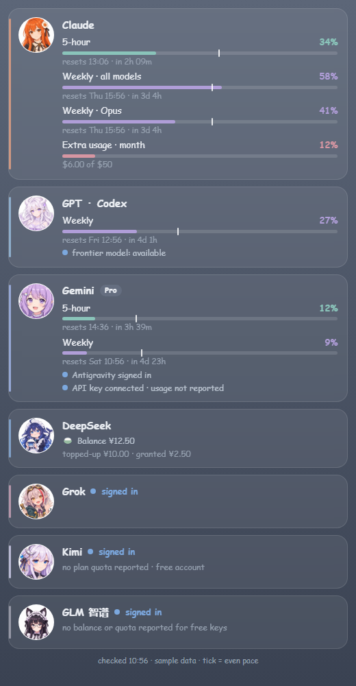
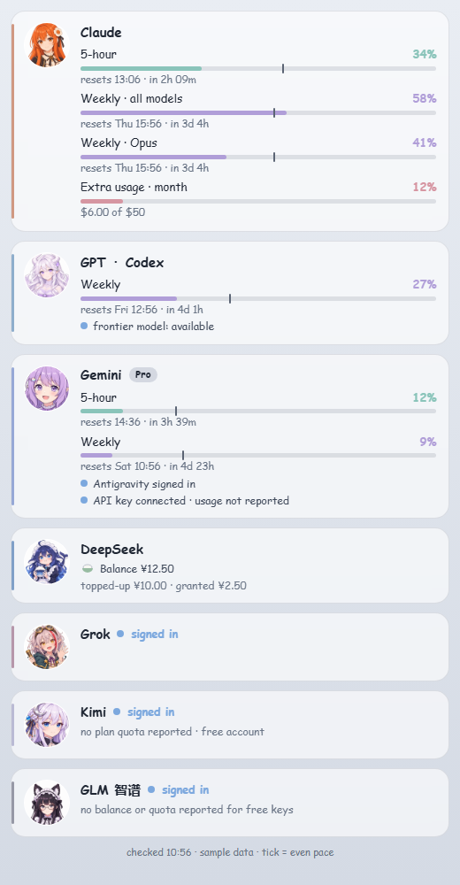

# AI Limits Monitor: T3 edition

A small live page that shows how much of your AI subscriptions you have used, made to sit in the right-panel **Preview** tab of [T3 Code](https://github.com/pingdotgg/t3code). It shows **Claude** and **Codex** usage limits, **Gemini** usage windows from Antigravity, a **DeepSeek** account balance, and sign-in status cards for **Grok, Kimi, Qwen, Doubao, GLM and MiniMax**.

This is the **T3 edition**. The **desktop edition**, a floating glass pane on the Windows desktop, is a separate project: [ai-limits-monitor](https://github.com/P3anutSweet/ai-limits-monitor). The two share the same usage readers and mascots.

| Dark | Light |
|---|---|
|  |  |

The screenshots show sample data (`--demo`), not a real account. The page follows your system's light or dark setting.

> **Unofficial data sources.** Claude and Codex usage is read from the internal endpoints the apps use for their own usage screens: `https://api.anthropic.com/api/oauth/usage` (Claude Code's login) and `https://chatgpt.com/backend-api/wham/usage` (Codex's login). These are **not public APIs**. They are undocumented and can change, be rate-limited or stop working at any time, and the numbers can differ from what the vendor bills. Use them only with your own account and under your provider's terms.

## How it works

`ai_limits_t3_v1.py` runs a small web server on **this PC only** (`127.0.0.1`, default port 47823). You open `localhost:47823` in T3 Code's Preview tab, and the page refreshes itself every 30 seconds.

Where the numbers come from (`source` setting):
- **`auto` (default):** if the desktop edition is running, its `latest.json` snapshot is used while it is fresh (15 minutes by default), so the vendors are not asked twice. Otherwise the page reads usage itself.
- **`file`:** only the desktop edition's `latest.json`.
- **`self`:** always read usage itself, with the same readers as the desktop edition (`ai_limits_core_v1.py`).

What each card shows:
- **Claude:** 5-hour session, weekly (all models), weekly per model when the plan has one, and monthly extra-usage credits.
- **Codex:** weekly limit, plus a 5-hour or per-model limit when the plan has one, and frontier-model availability.
- **Gemini:** Antigravity's own usage windows, as T3 Code caches them in `~/.t3/caches/antigravity.json`. If `GEMINI_API_KEY` is set, the key is checked with a token-free model listing; a valid key says nothing about usage or billing tier, so the card only says "API key connected · usage not reported".
- **DeepSeek:** account balance (topped-up and granted credit), read with the DeepSeek Harness sign-in in `~/.dsh/.credentials.yaml`.
- **Status cards** (sign-in dot plus vendor-reported free quota, never estimated):
  - **Grok:** `~/.grok/auth.json`.
  - **Kimi:** Kimi Code login file.
  - **Doubao:** `arkcli`.
  - **MiniMax:** `mmx`.
  - **GLM:** `ZAI_API_KEY`.
  - **Qwen:** recorded by hand in `<data_dir>\signin_status.json`.
- **Even-pace tick:** a thin tick on each bar marks where usage would be if spread evenly over the window.

## Requirements

- Python 3.12 (standard library only; nothing to install).
- [T3 Code](https://github.com/pingdotgg/t3code) to show the page in its Preview tab. Any browser works too.
- Signed-in CLIs for the services you enable (Claude Code, Codex, optionally T3 Code with Antigravity, DeepSeek Harness, Grok CLI, Kimi Code, `arkcli`, `mmx`). With `source: file`, only the desktop edition is needed.
- Tested on Windows 11. The Doubao and MiniMax cards call npm-installed CLIs through their Windows `.cmd` shims.

## Install and run

```powershell
git clone https://github.com/P3anutSweet/ai-limits-monitor-t3.git
cd ai-limits-monitor-t3
py -3.12 ai_limits_t3_v1.py            # serve the page (Ctrl+C stops)
py -3.12 ai_limits_t3_v1.py --demo     # sample data only
py -3.12 ai_limits_t3_v1.py --once     # print the data the page would show, then exit
```

Then, in T3 Code, open the right panel's **Preview** tab and enter `localhost:47823`. T3 keeps right-panel tabs per thread, so open it once in each thread where you want it.

To run it without a console window, use `pyw -3.12 ai_limits_t3_v1.py`. To start it at logon, create a shortcut in `shell:startup` to `pythonw.exe` with the full path of `ai_limits_t3_v1.py` as its argument.

## Settings

All settings are optional. Copy `ai_limits_t3_settings.example.json` to `ai_limits_t3_settings.json` next to the scripts and edit it. You can also point `AI_LIMITS_T3_SETTINGS` at a settings file elsewhere. Any key can be overridden with an environment variable named `AI_LIMITS_T3_<KEY>`, for example `AI_LIMITS_T3_PORT=47900` or `AI_LIMITS_T3_SERVICES=Claude,Codex`. Your `ai_limits_t3_settings.json` is in `.gitignore`.

| Key | Default | Meaning |
|---|---|---|
| `port` | `47823` | The page is at `http://localhost:<port>/` |
| `source` | `auto` | `auto`, `file` or `self` (see above) |
| `latest_json` | `%LOCALAPPDATA%\ai-limits-monitor\latest.json` | The desktop edition's snapshot |
| `max_age_minutes` | `15` | `auto` uses `latest.json` only when it is younger than this |
| `data_dir` | `%LOCALAPPDATA%\ai-limits-monitor-t3` | Small caches of the status cards |
| `avatar_dir` | `avatars` next to the script | `<key>_512.png` mascot heads |
| `services` | `Claude, Codex, Gemini, DeepSeek, Grok` | Any of `Claude, Codex, Gemini, DeepSeek, Grok, Kimi, Qwen, Doubao, GLM, MiniMax`, in page order |
| `time_zone` / `time_zone_label` | `local` / `""` | A fixed UTC offset in hours (e.g. `8`) and a label shown after times |
| `refresh_minutes` | `5` | How often the server reads usage (or re-reads `latest.json`) |
| `kimi_credentials`, `gemini_badge`, `gemini_notes` | `""`, `""`, `[]` | As in the desktop edition |
| `demo` | `false` | Same as `--demo` |

## Privacy and security

- The server listens on `127.0.0.1` only and answers only requests addressed to `localhost`, `127.0.0.1` or `[::1]` on its port. Requests from other hosts or names get "403 forbidden", which also blocks DNS-rebinding pages.
- It serves only three things: the page, a token-free usage feed (`/api/usage`) and the mascot images. It accepts only GET requests.
- Login tokens are only read from the files the vendor CLIs keep. They are never written, logged, printed or served, and are sent only to the vendor's own endpoint in a request header.
- The tool collects no telemetry and keeps no request log.

## Limits

- T3 Code has no plugin system. This page lives in the Preview tab, which T3 keeps per thread, and it only shows data while `ai_limits_t3_v1.py` is running.
- The Claude and Codex endpoints are unofficial (see above). When a vendor fails, the card keeps the last values and shows the error.
- Grok, Qwen and most status cards show sign-in state only, because those vendors report no plan usage for this tool to read.
- The Gemini card depends on T3 Code's cache. Without it, the card shows "unknown".

## Characters

The mascots in `avatars/` are the same **unofficial project illustrations** as in the desktop edition, made with AI image tools. They are not official artwork or characters of any vendor. How each image was made (prompts, tool, input images) is listed in [avatars/README.md](avatars/README.md). If you think an image is too close to someone's mark or character, please open an issue.

## Not affiliated

This is an independent tool. It is not affiliated with, endorsed by or sponsored by T3 Code or its makers, Anthropic, OpenAI, Google, DeepSeek, xAI, Moonshot AI (Kimi), Alibaba (Qwen), ByteDance / Volcengine (Doubao), Zhipu / Z.ai (GLM) or MiniMax. All product names are trademarks of their owners.

## License

Code: GPL-3.0, see [LICENSE](LICENSE).

Avatar images (`avatars/`, and the characters in `docs/`): CC BY 4.0, see [avatars/LICENSE](avatars/LICENSE) and [avatars/README.md](avatars/README.md) for attribution and how each image was made.
